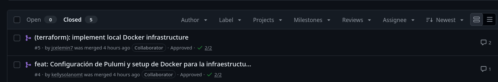
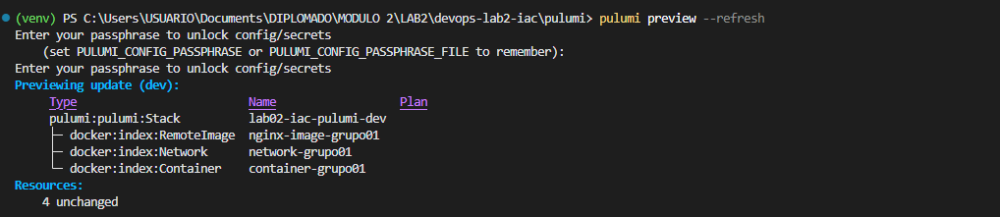
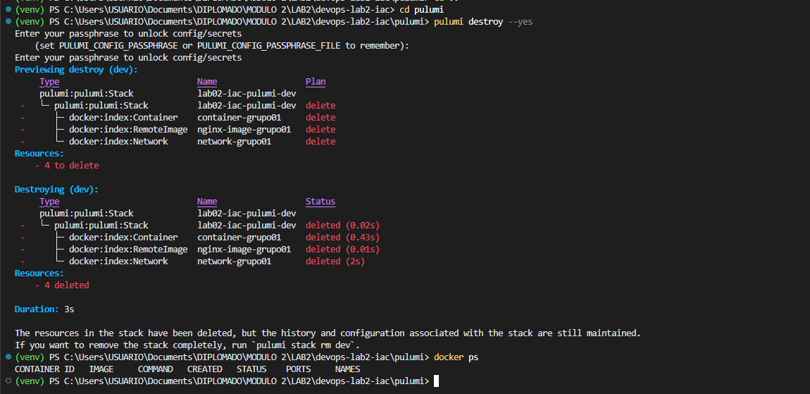

Grupo: grupo01

Integrantes:

* Jorge Celemin - R1 (Terraform)
* Kelly Johana Solano Calderon - R2 (Pulumi)
* Fabian Camilo Castro Lozano - R3 (Platform Lead)

**Observación**

Durante la ejecución del paso 3.1 Revisión cruzada de PRs, se cometió el error de que R1 y R2 hicieron merge de las ramas hacia main desde la interfaz de Github, bajo indicaciones de R3, esto fue producto de una confusión de creer que aprobar un PR implica hacer el merge también. Razón por la cual en el paso 4, R3 no pudo hacer el merge de las tres ramas (ya habían sido fusionadas).

---
### Matriz de comparación empírica
---

| Criterio de Comparación | Terraform (HCL) | Pulumi (Python) | Análisis del Grupo con Evidencia Observada |
|---|---|---|---|
| **1. Curva de aprendizaje y sintaxis** | DSL declarativo especializado | Lenguaje general orientado a objetos | La ingeniera Kelly tardó menos tiempo en configurar el contenedor debido a mayor familiaridad con python. Sin embargo, el equipo percibió que a nivel de infraestructura Terraform no requiere muchos pasos de configuración previa, a diferencia de Pulumi|
| **2. Líneas de código efectivas (LOC)** | 105 líneas - en main.tf| 51 líneas - en main.py | Terraform usa un lenguaje declarativo HCL, lo que agrega complejidad. El código de python de Pulumi es reutilizable y empaquetable en funciones, a diferencia de Terraform, que adicionalmente requiere archivos adicionales para aspectos como las variables|
| **3. Manejo del Estado (State)** | Archivo `terraform.tfstate` | Metadatos de Stack local en `~/.pulumi` | El archivo Terraform.tfstate se guarda en la misma carpeta donde se inicializa Terraform, mientras que Pulumi lo guarda en una ruta global en el directorio del usuario. Adicionalmente, el archivo de Terraform está formateado y es de fácil lectura, mientras que el archivo de Pulumi es un json de una sola línea que es largo y dificil de seguir incluso si se usa un formateador como jq|
| **4. Validación de variables y tipos** | Bloque `validation { condition = ... }` | Lógica en Python (`if ... raise ValueError`) | Desde nuestra perspectiva, la validación de sintaxis y errores de lógica Pulumi es más rápido y tiene la ventaja de que se puede hacer uso de todos los mecanismos del lenguaje Python para el manejo de errores y personalización de mensajes de excepción. A nivel de errores de aprovisionamiento de infraestructura, no se observó ninguna ventaja de alguna herramienta frente a otra |
| **5. Detección y corrección de Drift** | `terraform plan` | `pulumi preview --refresh` | Al eliminar los contenedores de manera manual y ejecutar el plan en Terraform, este lo detectó automáticamente, indicó que el cambio había venido desde afuera de Terraform y generó el plan detallado nuevamente para reponerlo. Por otra parte, Pulumi solo indicó que debía generar nuevamente el contenedor, pero no dio una razón, ni una configuración detallada para ello.|
| **6. Multiplicidad y ciclos** | Meta-argumento `count` / `for_each` | Bucle estándar `for` en listas Python | A nuestro parecer, Pulumi es más legible debido a que utiliza la misma notación de python para definir un loop, mientras que Terraform requiere cambiar el enfoque imperativo hacia uno declarativo, no se puede iterar por índice si no que se tiene que construir un set o un map, lo que hace parecer el código con más boilerplate|
| **7. Ecosistema de Linters / Shift-Left** | `terraform fmt`, `validate` | `ruff`, `flake8` | En el último merge con commit 1451695 se observó un tiempo de chequeo para Terraform de 8 segundos, frente a los 11 segundos de Pulumi, Terraform fue un poco más rápido|

---
### Evidencias del experimento del drift
---
En la máquina de R3 se ejecutan los comandos de remoción del docker tras haber aprovisionado ambas infraestructuras:

**Drift en terraform**

Se evidencia que el plan indica que ha habido un cambio en la infraestructura que se ha dado desde afuera de terraform, razón por la cual aprovisionará de nuevo la infraestructura y detalla la configuración resultante.

**Drift en Pulumi**

Se evidencia que Pulumi muestra que debe recrear la infraestructura, pero a diferencia de terraform no indica el motivo ni las características detalladas de la remediación.

Por su parte, se ejecuta el plan de aprovisionamiento de terraform en la máquina de R1:

De manera analoga, se ejecuta el preview de pulumi en la máquina de R2, que muestra lo siguiente

Se observa que para ambos casos no hay una planeación para cambiar la infraestructura, se demuestra la idempotencia de las herramientas.

Finalmente, se ejecutan los comandos de destroy en Terraform y Pulumi en las máquinas de R1 Y R2

---
### Si tuvieran que desplegar una arquitectura de microservicios en una empresa donde todos los desarrolladores son de Python pero no saben DevOps, ¿cuál }herramienta elegirían y qué precauciones tomarían?
---

Dada la familiaridad con el lenguaje de Python con la que cuenta el equipo de desarrollo, Pulumi es una mejor opción ya que va a reducir la curva de aprendizaje dentro del equipo y brindará una mejor comprensión de la Infraestructura como código que se está construyendo. Adicionalmente, dado que el equipo no tiene experiencia con prácticas de DevOps, otra alternativa es desarrollar herramientas de uso interno que mediante click ops que les permita hacer flujos de CI/CD. 

Como puntos a sugerir, hay que tener en cuenta que Pulumi debe hacer gestión de secretos, por lo que usar un Passphrase local es una mala práctica, se debería hacer una integración con un secrets provider como Hashicorp Vault, AWS secret management service, entre otros, para no tener que compartir secretos por vias externas e inseguras. Cada cambio sobre la base de código, se debería hacer con una pull request y commit comentados, tal y como se hizo en el laboratorio, para tener una capacidad de auditar y revertir cambios que generen efectos inesperados. El acceso directo a los ambientes de producción debería ser restringido a una única persona o a un grupo pequeño para reducir el riesgo de drifts de infraestructura.